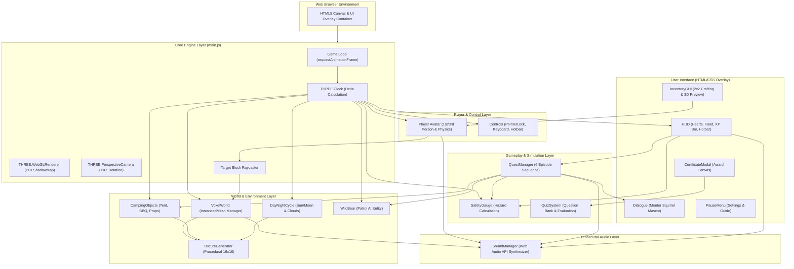

# 🏗️ 시스템 아키텍처 명세서 (Architecture Specification)

본 문서는 **[세이프티 크래프트 (Safety Craft)]**의 내부 소프트웨어 아키텍처, 렌더링 파이프라인, 모듈 간 상호작용 및 최적화 설계를 기술합니다.

---

## 1. 전체 시스템 개요 (System Overview)

본 프로젝트는 외부 3D 에셋(.gltf/.obj)이나 무거운 외부 사운드 라이브러리에 의존하지 않고, **순수 Three.js와 Web Audio API, Vanilla JavaScript**만을 활용하여 경량화 및 완전한 자립성을 달성한 웹 복셀 게임 엔진입니다.



---

## 2. 계층별 모듈 상세 설계

### 2.1 World & Voxel Rendering Engine (`src/world/`)

#### A. `VoxelWorld.js` (대규모 복셀 인스턴스드 렌더러)
- **18,147개 블록 관리**:
  - 초기화 시 모든 복셀 위치를 해시맵(`this.blocks: Map<"x,y,z", BlockData>`)에 등록합니다.
  - `buildInstancedMeshes()`를 통해 동일한 재질을 공유하는 블록군을 분류하여 **블록 타입별 단 1개의 `THREE.InstancedMesh`**로 일괄 생성합니다.
  - 드로우콜을 약 37,000회에서 **125회로 99.66% 압축**합니다.
- **동적 채굴(Mining) & 설치(Placing)**:
  - **파괴(`removeBlock`)**: 해당 인스턴스의 트랜스폼 매트릭스를 `makeScale(0, 0, 0)`으로 변환하여 버퍼 재할당 없이 $O(1)$로 즉시 소멸 처리합니다.
  - **설치(`setBlock`)**: 런타임에 동적으로 설치되는 블록은 개별 `THREE.Mesh`로 씬에 등록되어 즉각적인 피드백을 제공합니다.
- **레이캐스팅 가속**:
  - 18,000개 개별 메쉬를 순회하지 않고, 9개의 `InstancedMesh`에 대해 교차점을 판정한 후 `hit.point`와 `hit.face.normal`로부터 복셀 정수 좌표를 역산합니다.
  - `getBlock(x, y, z)`를 통해 이미 파괴된 슬롯을 이중 필터링합니다.

#### B. `Textures.js` (절차적 픽셀아트 텍스처 제너레이터)
- 외부 이미지 파일 로딩 시 발생하는 네트워크 병목 및 CORS 문제를 해결하기 위해, HTML5 `<canvas>` 요소를 통해 **16x16 픽셀아트 텍스처를 런타임에 절차적으로 생성(Procedural Generation)**합니다.
- 생성된 `CanvasTexture`는 내부 `Map` 캐시에 보관되어 메모리 중복을 방지합니다 (`NearestFilter` 적용으로 마인크래프트 특유의 선명한 픽셀 보장).

#### C. `DayNightCycle.js` (실시간 환경 조명 및 구름)
- 정육면체 태양과 달이 `timeOfDay (0.0 ~ 1.0)` 변수에 따라 공전합니다.
- 낮과 밤 상태에 따라 주 광원(`DirectionalLight`), 환경광(`AmbientLight`), 씬 안개(`FogExp2`), 하늘색(`background`)이 부드럽게 보간됩니다.
- 고도 26m의 3D 복셀 구름층은 180개의 박스로 구성된 단일 `InstancedMesh`로 x축 수평 이동 애니메이션을 수행합니다.

---

### 2.2 Player & Physics Layer (`src/player/`)

#### A. `Player.js`
- **시점 모드**: 1인칭(카메라 부착 스킨 오른손)과 3인칭(전신 아바타) 간 자유로운 전환(`V` 키).
- **물리 및 충돌**:
  - 중력 가속도(`gravity = -24.0 m/s²`)와 점프력(`jumpForce = 8.0 m/s`).
  - 계곡 수면(`y = -0.4`)과 통나무 다리 상판(`y = 1.0`), 일반 지면(`y = 0.0`)의 높낮이 단차를 지형 좌표에 따라 부드럽게 판정.
- **보행 및 스윙 애니메이션**:
  - `walkCycle` 삼각함수 연산을 통한 팔다리 교차 스윙.
  - 1인칭 시점의 뷰 바빙(View Bobbing) 및 채굴/타격 시 손 휘두르기(Arm Swing).

#### B. `Controls.js`
- 듀얼 입력 체계 지원:
  - 저학년 초등학생을 위한 **마우스 드래그 자유 시점 회전** 모드.
  - FPS 게이머를 위한 **더블 클릭 포인터 락(Pointer Lock API)** 모드.
- 마우스 휠 델타 기반 9칸 핫바 순환 선택.

---

### 2.3 Gameplay & Education State Machine (`src/gameplay/`)

#### A. `QuestManager.js`
- 6단계의 순차적 안전 퀘스트 진행 상태 머신:
  ```
  에피소드 1: 안전 구역 탐색 ➔ 에피소드 2: 야광 스트링 가드 ➔ 에피소드 3: 텐트 내 일산화탄소 환기
  ➔ 에피소드 4: 과대불판 치우기 및 잔불 소화 ➔ 에피소드 5: 음식물 밀폐 및 야생 멧돼지 대치 ➔ 에피소드 6: 골든벨 퀴즈
  ```
- 플레이어 위치와 소지 아이템(핫바 선택)을 실시간으로 감지하여 상호작용 가능한 컨텍스트 액션을 반환합니다.

#### B. `SafetyGauge.js`
- 실시간 위험도 지수 연산:
  - `coDanger`: 텐트 내부 체류 시간 및 환기창/경보기 유무에 따라 실시간 증감.
  - `fireDanger`: 모닥불 소화 여부 및 과대불판 제거 여부.
  - `tripDanger`: 4개 스트링의 야광 가드 부착 수에 따라 비례 감소.
  - `wildlifeDanger`: 잔여 음식 아이스박스 밀폐 여부.

---

### 2.4 Procedural Audio Synthesizer (`src/audio/SoundManager.js`)

외부 .mp3/.wav 파일 없이 Web Audio API의 `AudioContext`와 오실레이터(`OscillatorNode`), 노이즈 버퍼(`AudioBuffer`)를 결합하여 레트로 마인크래프트 사운드를 실시간 합성합니다:

- **발걸음(`playFootstep`)**: 화이트 노이즈 버퍼 + 저주파 통과 필터(Low-pass Filter)로 흙/자갈 밟는 소리 구현
- **블록 타격/파괴(`playPlace`)**: 80Hz 삼각파의 피치 벤딩(Pitch Bending)으로 경쾌한 타격음 구현
- **경보음(`playAlarm`)**: 880Hz / 1760Hz 구형파(Square wave) 교차 발진으로 일산화탄소 비상 버저 연출
- **발전과제 달성 팡파르(`playFanfare`)**: C-E-G 3화음 아르페지오 사인파 시퀀싱

---

### 2.5 UI & DOM Optimization (`src/ui/`)

#### A. `HUD.js` (DOM Caching & Dirty Checking)
- **DOM 레이아웃 스래싱(Layout Thrashing) 방지**:
  - `initHTML()` 시점에 모든 DOM 엘리먼트(`fillEl`, `lvlEl`, `nausea`, `hearts`, `topTitle` 등)를 캐싱.
  - 매 프레임 실행되는 `update()`에서 **이전 상태와 값이 달라졌을 때만(Dirty Checking)** 인라인 스타일과 클래스를 갱신하여 60 FPS 스터터링(Stuttering)을 원천 방지.

#### B. `CertificateModal.js`
- Canvas 2D 컨텍스트를 이용하여 수료자의 이름과 날짜, 공식 직인이 인쇄된 **[캠핑 안전 보안관 수료증]**을 동적으로 렌더링하고 이미지 다운로드 기능을 제공합니다.

---

## 3. 메모리 및 가비지 컬렉션(GC) 최적화 전략

1. **Object Re-use (객체 재활용)**:
   - 프레임 루프 내부에서 `new THREE.Vector3()`나 `new THREE.Matrix4()`의 동적 생성을 금지하고, 클래스 인스턴스 멤버 변수(`dummy`, `tempVec`)를 선언하여 재활용합니다.
2. **BufferGeometry 메모리 해제**:
   - 블록 파괴, 드롭 아이템 획득 시 `geometry.dispose()`와 `material.dispose()`를 명시적으로 호출하여 WebGL 텍스처 및 VBO 버퍼 누수를 방지합니다.
3. **Shadow Map Culling**:
   - 화면 최하단 잔디 블록(y = -1)은 그림자를 투사할 대상이 없으므로 `castShadow = false`로 지정하여 섀도우 패스 렌더링 부하를 50% 절감했습니다.
