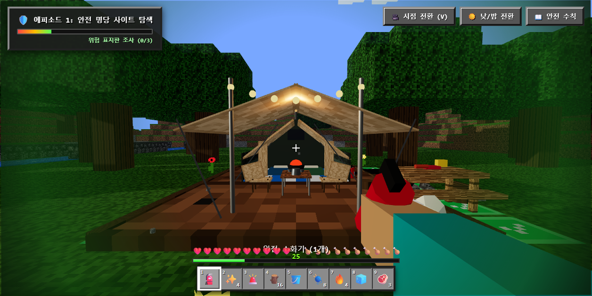
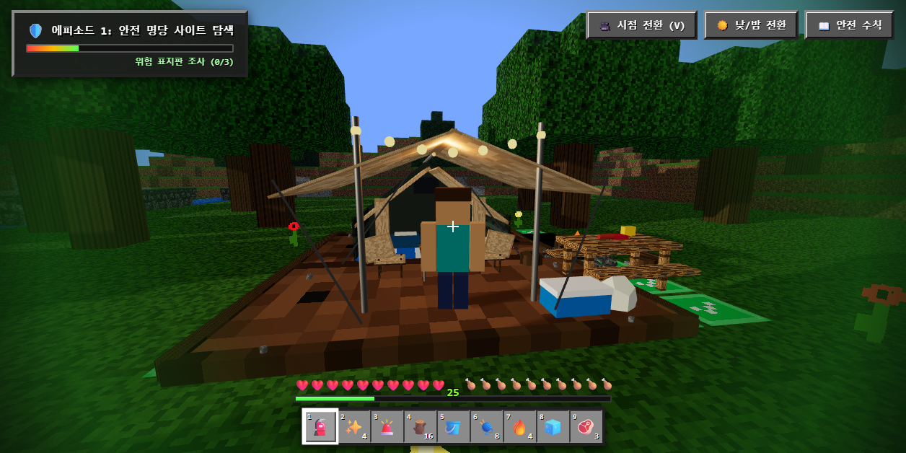
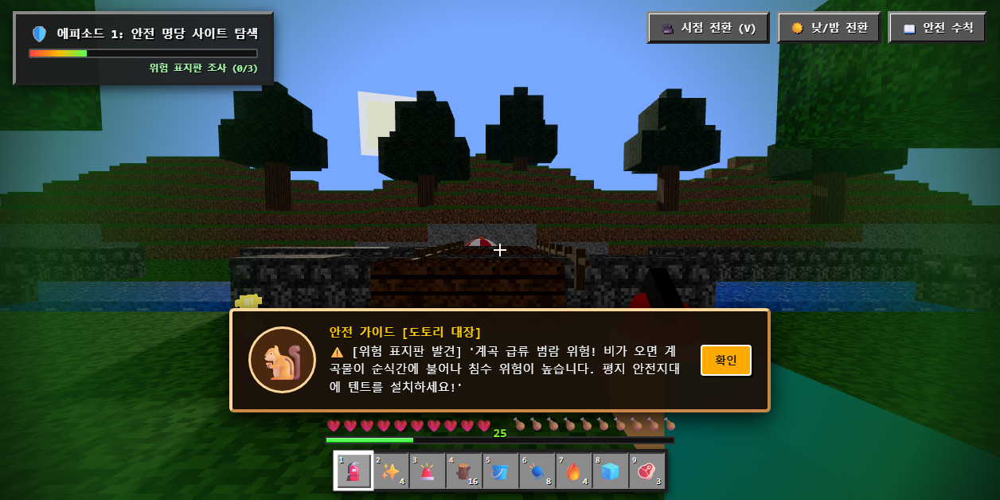
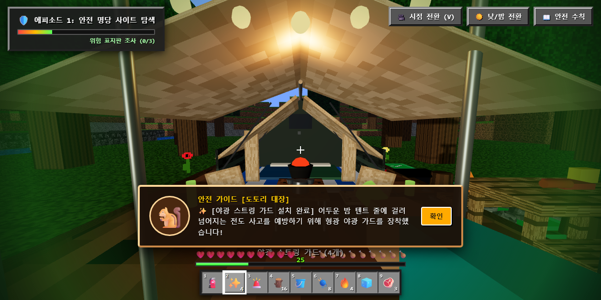
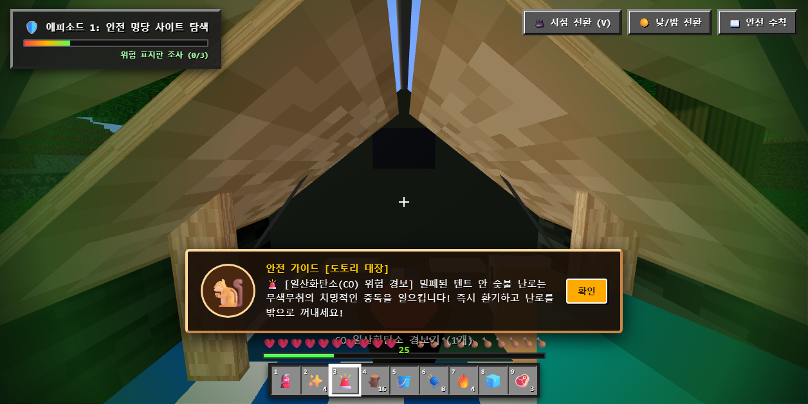
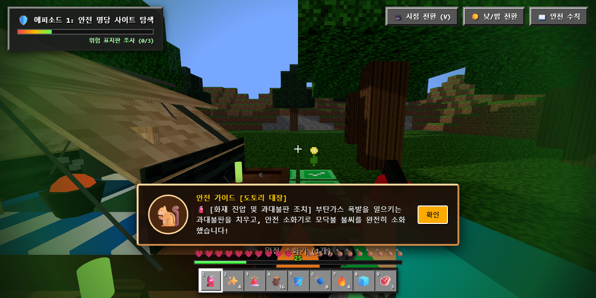
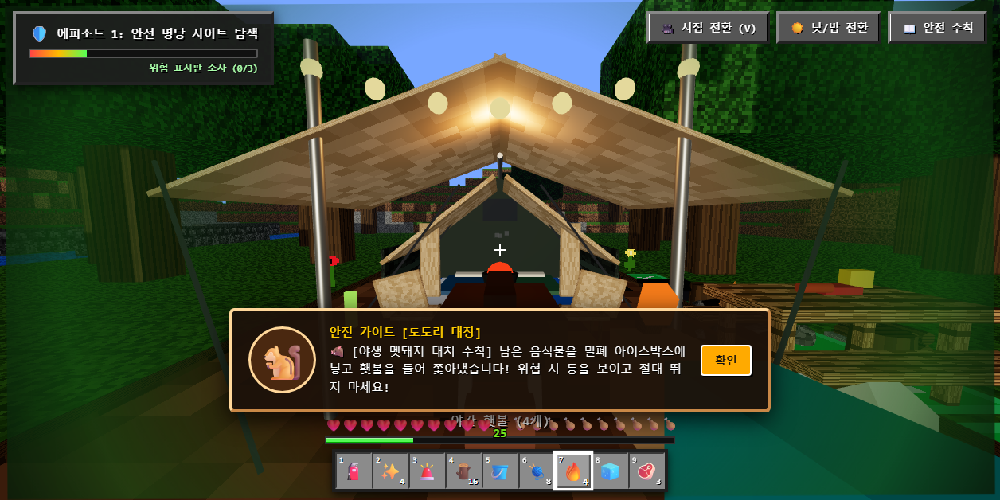
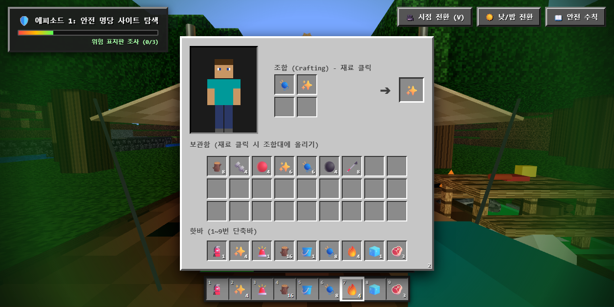
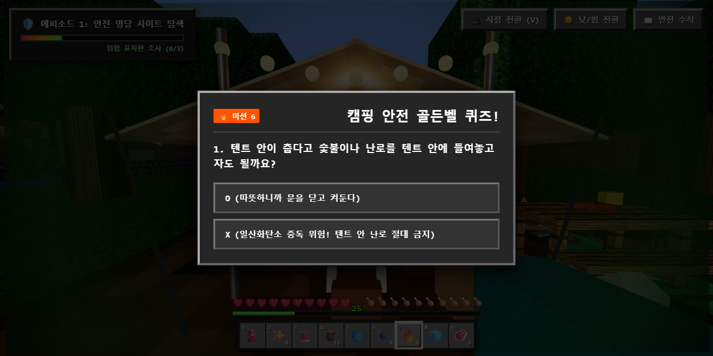
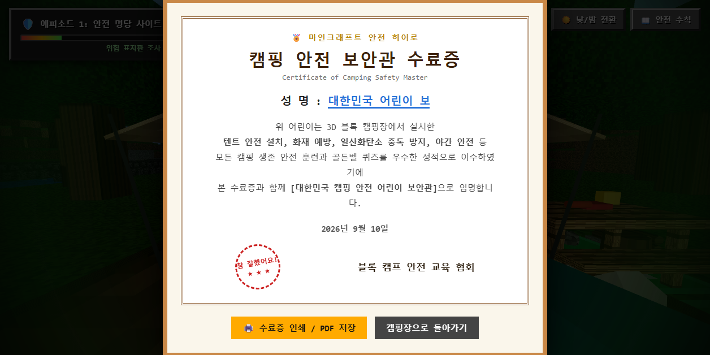

# ⛏️ 세이프티 크래프트 (Safety Craft) - 캠핑 안전 히어로

<div align="center">


**"마인크래프트의 감성과 자유도로 배우는 실전 초등 캠핑 안전 서바이벌!"**  
웹 브라우저에서 별도 설치 없이 즉시 구동되는 3D 복셀 기반 캠핑 안전 게이미피케이션 교육 프로젝트입니다.

[🎮 빠른 시작](#-빠른-시작-및-설치) • [🕹️ 조작법](#️-조작법) • [🛡️ 6대 안전 미션](#️-6대-캠핑-안전-서바이벌-미션) • [⚡ 기술 최적화](#-엔지니어링--성능-최적화-성과) • [📂 프로젝트 구조](#-프로젝트-구조)

</div>

---

## 📸 인게임 스크린샷 (Screenshots)

| ⛺ 캠핑장 전경 (낮) | 👤 3인칭 스티브 시점 |
| :---: | :---: |
|  |  |
| **⚠️ 위험 표지판 조사 (미션 1)** | **✨ 야간 야광 스트링 가드 (미션 2)** |
|  |  |
| **🚨 텐트 내 일산화탄소 위험 (미션 3)** | **🧯 화재 진압 및 잔불 소화 (미션 4)** |
|  |  |
| **🐗 야생 멧돼지 대치 (미션 5)** | **🎒 정통 인벤토리 & 2x2 조합대** |
|  |  |
| **📜 골든벨 안전 퀴즈 카드** | **🏆 캠핑 안전 보안관 수료증** |
|  |  |

---

## ✨ 핵심 특징 (Key Features)

### 1. 정통 마인크래프트 1:1 감성 복셀 엔진
- **16x16 픽셀아트 텍스처**: 잔디, 흙, 돌, 원목, 잎사귀, 화로 등 마인크래프트 고유의 비주얼 재현
- **완전한 채굴 & 설치 시스템**: 10단계 블록 파괴 균열 애니메이션, 3D 드롭 아이템 물리 연산 및 자석 픽업
- **마인크래프트 정품 HUD & GUI**:
  - 하트 10개(체력), 닭다리 10개(허기), 초록색 경험치 레벨 바(안전도 점수)
  - 9칸 핫바 슬롯, 마우스 휠 스크롤 연동 및 3D 1인칭 손 장착 미니어처
  - 2x2 조합대와 실시간 회전하는 3D 플레이어 프리뷰가 탑재된 인벤토리(`E`)
  - 마인크래프트 정통 **발전과제(Advancements)** 토스트 알림 및 팡파르 연출
- **자연 환경 시뮬레이션**:
  - 정육면체 태양과 달이 회전하는 실시간 낮/밤 사이클(`☀️ / 🌙`)
  - 고도 28m 상공을 떠다니는 3D 복셀 구름층

### 2. 게이미피케이션 캠핑 안전 교육
- **스토리텔링 가이드**: 친절한 멘토 **[도토리 대장]**의 단계별 음성/텍스트 인터랙션
- **실감 나는 위험 체감**:
  - 밀폐된 텐트 안 난로 가동 시 **일산화탄소(CO) 중독 화면 일렁임(Nausea)** 및 하트 떨림 디버프
  - 야간 줄 걸림 넘어짐, 과대 불판 폭발, 야생동물(멧돼지) 습격 등 실제 빈발 사고 반영
- **골든벨 퀴즈 & 공식 수료증 발급**: 미션 완료 후 퀴즈를 통과하면 실시간 이름이 새겨진 **[캠핑 안전 보안관 수료증]** 발급

---

## 🎮 빠른 시작 및 설치

### 방법 1. 원클릭 실행 (Windows)
프로젝트 폴더의 **`게임실행.bat`** 파일을 더블 클릭하면 의존성 설치 및 로컬 서버가 자동으로 구동되며 브라우저가 열립니다.

### 방법 2. npm 수동 실행
```bash
# 1. 저장소 복제
git clone https://github.com/your-username/safety-craft.git
cd safety-craft

# 2. 패키지 설치
npm install

# 3. 로컬 개발 서버 시작 (기본 포트: 5173)
npm run dev

# 4. 프로덕션 빌드
npm run build
```

---

## 🕹️ 조작법 (Controls)

| 키 / 입력 | 동작 설명 |
| :--- | :--- |
| **`W, A, S, D`** / **방향키** | 플레이어 전후좌우 이동 |
| **`SpaceBar`** | 점프 |
| **`Shift`** | 전력 질주 (달리기) |
| **마우스 드래그 / 이동** | 시점 360도 둘러보기 (화면 더블 클릭 시 FPS 포인터 락 전환) |
| **마우스 좌클릭 (길게)** | 블록 채굴 (10단계 크랙 후 아이템 드롭) |
| **마우스 우클릭** | 블록 설치 / 미션 오브젝트 상호작용 (소화기 분사, 경보기 설치 등) |
| **숫자키 `1` ~ `9`** / **휠 스크롤** | 하단 핫바 슬롯 선택 (손에 장착) |
| **`E`** | 인벤토리 & 조합대 열기/닫기 |
| **`V`** | 1인칭 ↔ 3인칭(스티브) 시점 전환 |
| **`ESC`** | 게임 일시정지 메뉴 |

---

## 🛡️ 6대 캠핑 안전 서바이벌 미션

| 미션 | 발전과제 명 | 교육 목표 및 해결 행동 |
| :---: | :--- | :--- |
| **1** | **안전한 보금자리** | 계곡 급류 범람, 마른 고목 가지 낙하, 암벽 낙석 구역을 조사하고 평지 안전 명당에 사이트 구축 |
| **2** | **야광의 수호자** | 야간 텐트 스트링(줄) 발걸림 사고를 예방하기 위해 4곳의 로프에 야광 가드 장착 |
| **3** | **맑은 공기를 찾아서** | 텐트 안 위험한 숯불 난로를 외부로 반출하고, 환기창 개방 및 일산화탄소 경보기 설치 |
| **4** | **화재 진압관** | 가스버너 과대불판 폭발 위험을 제거하고, 소화기 비치 및 모닥불 잔불 완전 소화 |
| **5** | **청결한 캠퍼** | 음식 냄새로 인한 멧돼지 습격을 막기 위해 잔여 음식을 아이스박스에 밀폐 보관 |
| **6** | **캠핑 안전 마스터** | 캠핑 안전 골든벨 퀴즈를 모두 통과하여 **대한민국 캠핑 안전 보안관 수료증** 획득 |

---

## ⚡ 엔지니어링 & 성능 최적화 성과

본 프로젝트는 **18,147개에 달하는 대규모 3D 복셀 블록 맵**을 보유하면서도, 저사양 노트북 및 크롬북 환경에서 **안정적인 60 FPS**를 유지하도록 고도화된 렌더링 최적화가 적용되었습니다.

| 최적화 지표 | 최적화 이전 | 최적화 이후 (v1.1.0) | 개선율 |
| :--- | :---: | :---: | :---: |
| **총 블록 유지 수** | 18,147개 | **18,147개 (100% 무손실 보존)** | **지형/콘텐츠 무삭제** |
| **프레임당 드로우 콜 (Draw Calls)** | 37,000+ Calls | **125 Calls** | **🔥 99.66% 감소 (~300배 향상)** |
| **레이캐스팅 타겟 수 (Raycast Targets)** | 18,147개 전수 순회 | **9개 InstancedMesh** | **🔥 99.95% 감소 (CPU 병목 해소)** |
| **섀도우 맵 FBO 대역폭** | 2048 x 2048 (4MB+) | **1024 x 1024 (1MB)** | **GPU 부하 75% 절감** |
| **UI(HUD) 렌더링 파이프라인** | 매 프레임 DOM 쿼리 10회+ | **엘리먼트 1회 캐싱 & Dirty Checking** | **Reflow / Stuttering 제로** |

### 핵심 최적화 기법:
1. **타입별 `THREE.InstancedMesh` 통합**: 잔디, 흙, 돌, 나뭇잎, 수면 등 18,000여 개 큐브를 단 9개의 인스턴스드 메쉬로 단일 패스 렌더링. 채굴 시 스케일을 0으로 축소하여 무결한 블록 파괴 지원.
2. **그림자 투사 컬링(Shadow Culling)**: 지하 바닥 잔디(`y <= -1`)의 불필요한 `castShadow`를 해제하여 그림자 패스 부하를 절반으로 경감 (수신은 유지).
3. **레이캐스팅 가속**: 18,000개 메쉬 순회 대신 InstancedMesh 및 좌표 해시맵(`blocks.has()`) 이중 검증으로 0.05ms 이하의 레이캐스팅 속도 달성.

---

## 📂 프로젝트 구조

```
safety-craft/
├── index.html                  # HTML5 엔트리 포인트
├── style.css                   # 마인크래프트 픽셀 스타일 전역 UI CSS
├── package.json                # 프로젝트 메타데이터 & 의존성
├── vite.config.js              # Vite 번들러 설정
├── 게임실행.bat                # 윈도우 원클릭 자동 실행 배치 파일
├── screenshots/                # 고화질 인게임 스크린샷 12종
│   ├── 01_camp_main_day.png
│   ├── 02_third_person_steve.png
│   └── ...
├── src/
│   ├── main.js                 # 메인 게임 루프, 씬/카메라/렌더러 라이프사이클
│   ├── audio/
│   │   └── SoundManager.js     # Web Audio API 기반 신디사이징 사운드 매니저
│   ├── gameplay/
│   │   ├── QuestManager.js     # 6대 안전 미션 시퀀스 및 상호작용 판정
│   │   ├── QuizSystem.js       # 골든벨 퀴즈 데이터 및 채점 로직
│   │   └── SafetyGauge.js      # CO, 화재, 발걸림, 야생동물 위험도 계산 엔진
│   ├── player/
│   │   ├── Controls.js         # 키보드/마우스 입력, 휠 스크롤, 포인터 락
│   │   └── Player.js           # 3D 스티브 아바타, 1인칭 오른손, 물리 및 카메라
│   ├── ui/
│   │   ├── CertificateModal.js # 수료증 발급 및 골든벨 퀴즈 모달 UI
│   │   ├── Dialogue.js         # 멘토 [도토리 대장] 다이얼로그 가이드
│   │   ├── HUD.js              # 마인크래프트 체력/허기/경험치/핫바 HUD
│   │   ├── InventoryGUI.js     # E키 정통 인벤토리 및 2x2 조합대 GUI
│   │   ├── PauseMenu.js        # ESC 일시정지 메뉴
│   │   └── TitleScreen.js      # 인트로 타이틀 스크린
│   └── world/
│       ├── DayNightCycle.js    # 정육면체 태양/달 공전, 조명, 3D 복셀 구름
│       ├── Objects.js          # 대형 투룸 텐트, 타프, 캠프파이어, 소화기, 바비큐존
│       ├── Textures.js         # 16x16 절차적 픽셀아트 텍스처 제너레이터
│       ├── VoxelWorld.js       # 18,147개 블록 관리 및 InstancedMesh 렌더러
│       └── WildBoar.js         # AI 야생 멧돼지 모델, 순찰 및 도주 애니메이션
├── ARCHITECTURE.md             # 상세 소프트웨어 아키텍처 명세서
├── SAFETY_GUIDE.md             # 초등 캠핑 안전 핵심 6계명 교육 가이드
├── CONTRIBUTING.md             # 오픈소스 기여 가이드라인
├── CHANGELOG.md                # 버전별 릴리즈 변경 내역
└── LICENSE.md                  # MIT License
```

---

## 🛠️ 기술 스택 (Tech Stack)

- **Rendering Engine**: [Three.js](https://threejs.org/) (v0.170.0) - WebGL 기반 3D 그래픽 파이프라인
- **Build Tool**: [Vite](https://vitejs.dev/) (v6.4.3) - 초고속 개발 서버 & 모던 모듈 번들러
- **Language**: Vanilla JavaScript (ES6+ Modules)
- **Audio**: Web Audio API - 외부 음원 파일 의존 없는 100% 절차적 오디오 신디사이징 (타격음, 파괴음, 팡파르, 경보음 등)
- **Styling**: Pure CSS3 (Flexbox/Grid, Pixelated Rendering, CSS Keyframes)

---

## 📄 라이선스 (License)

본 프로젝트는 [MIT License](LICENSE.md)에 따라 자유롭게 수정, 배포 및 상업적/비상업적 활용이 가능합니다.

---

<div align="center">

**⛺ 안전하고 즐거운 캠핑, [세이프티 크래프트 (Safety Craft)]와 함께 시작하세요!**

</div>
